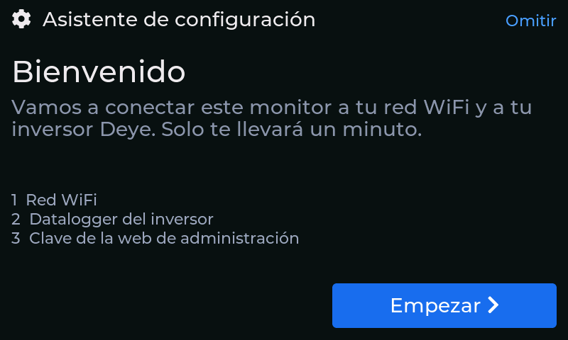
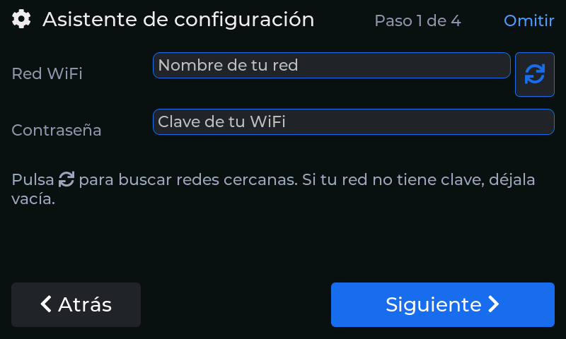
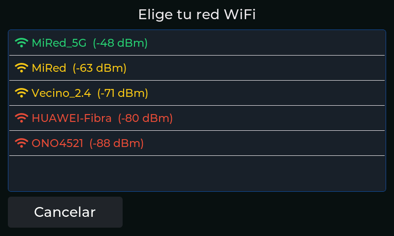
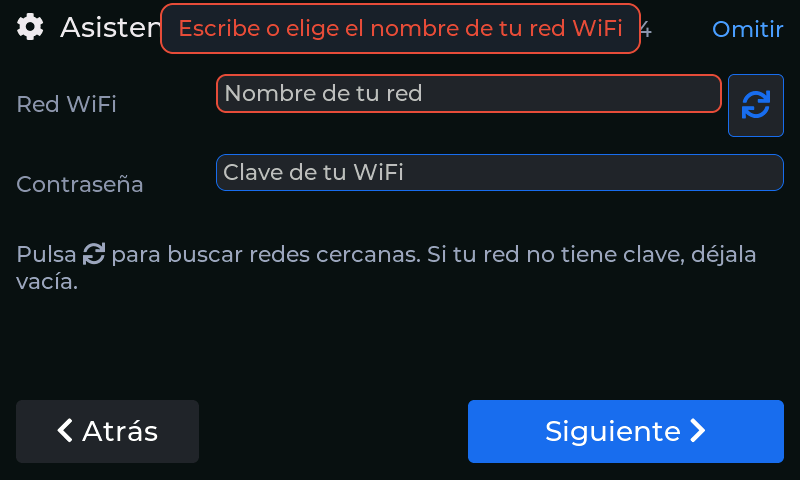
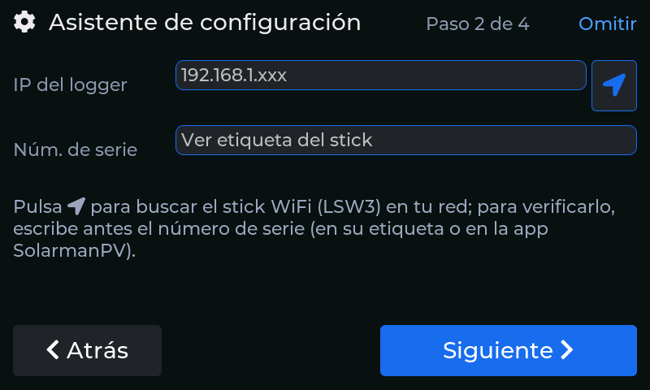
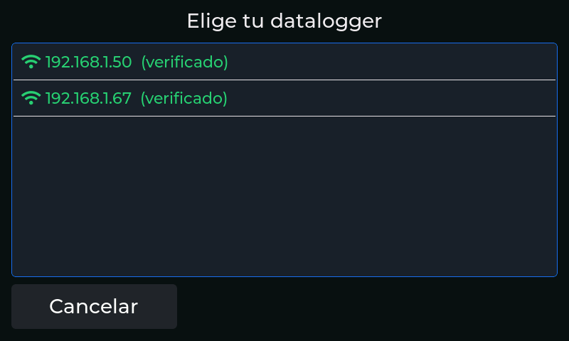
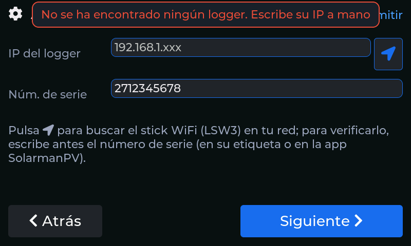
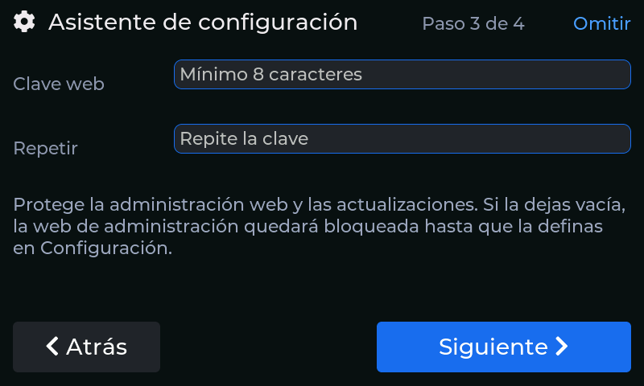
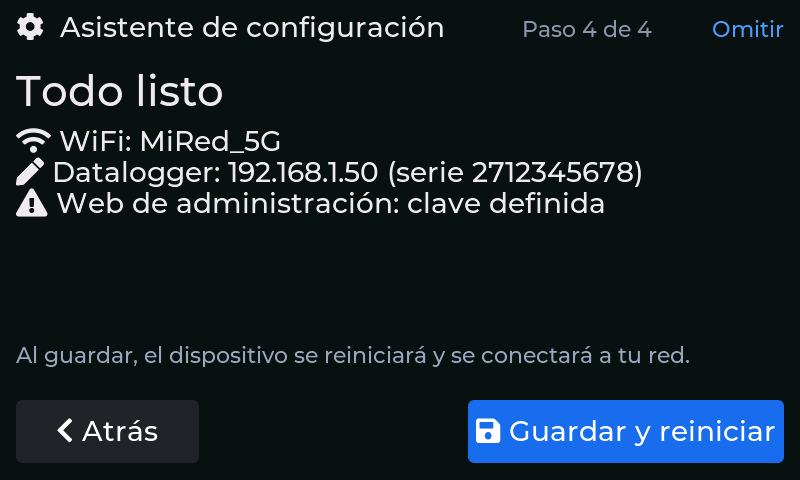

# Primeros pasos

Este capítulo recorre lo que ocurre desde que enciendes el equipo por primera vez hasta que ves
tus datos en pantalla, y explica cómo moverte entre las pantallas.

## Qué necesitas antes de empezar

Ten a mano estos datos; el asistente de configuración te los pedirá:

- **El nombre y la contraseña de tu red WiFi** (de 2,4 GHz: es la misma a la que está conectado el
  stick del inversor).
- **La dirección IP del stick WiFi** del inversor. La puedes ver en la lista de dispositivos de tu
  router, pero el equipo también la puede **buscar solo** (ver más abajo).
- **El número de serie del stick**, que está en su etiqueta o en la aplicación SolarmanPV
  (*Dispositivo → S/N*). Es un número de unas diez cifras.

## Pantalla de arranque

Al encenderse, el equipo muestra una pantalla de arranque con el avance de cada paso: almacenamiento,
histórico, caché, hora (NTP), WiFi, servidor web y Telegram. Tarda unos segundos; cuando termina,
pasa sola al panel principal. Si algún paso no puede completarse (por ejemplo, la WiFi todavía no
está configurada), lo marca con un aviso pero el equipo sigue arrancando.

## Asistente de primer arranque

Si el equipo **no tiene ninguna WiFi guardada**, tras la pantalla de arranque aparece un asistente
a pantalla completa que te guía en cuatro pasos. Puedes salir en cualquier momento con **Omitir**
(arriba a la derecha): te pedirá confirmación y, si lo omites, no volverá a aparecer; todo lo que
hace el asistente se puede hacer más tarde desde [Configuración](06-configuracion.md).



**Bienvenida.** Pulsa **Empezar**.

### Paso 1 — Red WiFi



Escribe el nombre de tu red o pulsa el botón de **búsqueda** (el icono de flechas circulares) junto
al campo: el equipo escanea las redes cercanas y te las muestra **ordenadas por intensidad de
señal** (verde: buena, amarillo: justa, rojo: débil). Toca la tuya para rellenar el campo y escribe
la contraseña. Si tu red es abierta, deja la contraseña vacía; si no, debe tener entre 8 y 63
caracteres.



Si dejas el nombre vacío, el campo se marca en rojo y un aviso te explica qué falta.



Al pulsar **Siguiente**, el equipo se conecta ya a tu red para que el paso siguiente pueda buscar el
inversor.

### Paso 2 — Inversor



Aquí indicas dónde está el stick WiFi del inversor:

1. Escribe el **número de serie** (solo dígitos).
2. Pulsa el botón de **localización** junto al campo de la IP. El equipo busca el stick en tu red
   (tarda unos dos segundos). Como ya conoce el número de serie, **verifica** cada dispositivo que
   responde con una lectura real y solo te ofrece los que realmente son tu inversor.
3. Si encuentra uno, rellena la IP y te lo indica; si encuentra varios, te los muestra para que
   elijas.



Si no encuentra ninguno, te avisa y puedes escribir la IP a mano.



!!! note "El número de serie no se puede detectar solo"
    El stick no envía su número de serie al ser buscado, por eso hay que escribirlo. Sin él, la
    búsqueda encuentra el dispositivo pero no puede confirmar que sea el tuyo (lo indica como «sin
    verificar»).

### Paso 3 — Clave de administración



Define la **clave de la web de administración** (mínimo 8 caracteres, escrita dos veces). Con ella
podrás entrar en la página de administración y actualizar el firmware desde el navegador. Es
opcional, pero **sin clave esas páginas quedan bloqueadas** (ver [Interfaz web](07-interfaz-web.md)).
Se puede definir más tarde en **Configuración → Acceso web**.

### Paso 4 — Resumen



Revisa los datos y pulsa **Guardar y reiniciar**. El equipo guarda la configuración, se reinicia y
arranca ya conectado a tu red y leyendo tu inversor.

## Moverse por las pantallas

El equipo tiene **cinco pantallas** dispuestas en horizontal. Se pasa de una a otra **deslizando el
dedo** a izquierda o derecha:

```
Panel  ←→  Gráfica  ←→  Estadísticas  ←→  Perfil de energía  ←→  Configuración
```

- Los **puntos** del borde inferior indican en cuál estás. **Se pueden tocar** para saltar
  directamente a esa pantalla.
- El botón de la **casa**, en la esquina superior izquierda de todas las pantallas salvo el panel,
  te devuelve al panel principal. El equipo te lo recuerda con un aviso la primera vez que
  cambias de pantalla (y te avisa también de que la barra superior del panel cambia la vista).
  Cada pista se muestra una sola vez.
- Los **avisos temporales** (confirmaciones, errores de un campo) aparecen en una franja sobre la
  pantalla y desaparecen solos.

## Acceder desde el navegador

Una vez conectado, el equipo es también una pequeña web. Escribe en cualquier navegador de tu red:

- `http://inversor.local` (el nombre `inversor` se puede cambiar en Configuración → Red), o
- `http://` seguido de la IP del equipo, que puedes ver en **Configuración → Red**.

Más detalles en [Interfaz web](07-interfaz-web.md).
