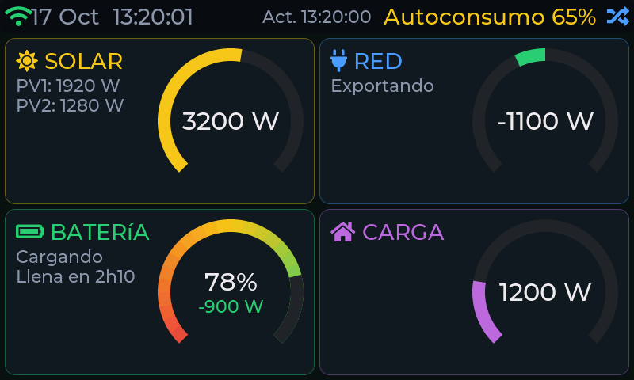
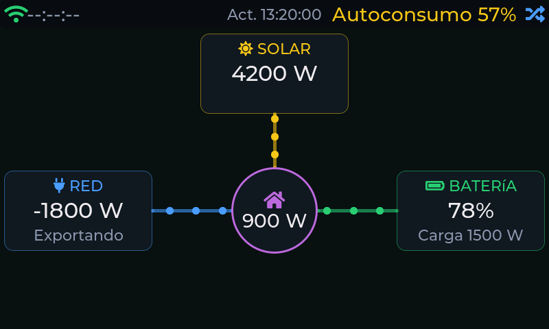
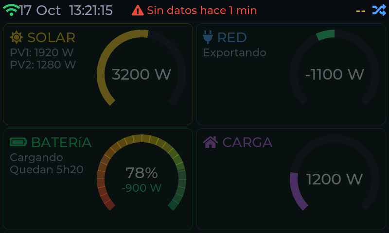
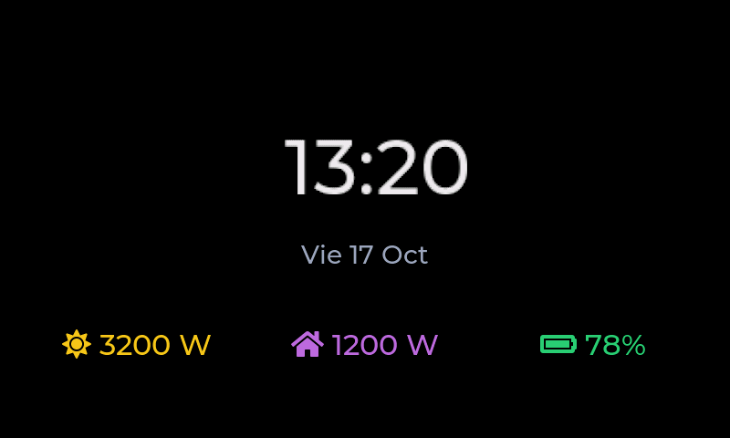

# Panel principal

Es la primera pantalla: todo lo que está pasando **ahora mismo** en tu instalación, actualizado cada
cinco segundos.

## Barra superior

- A la izquierda, el **icono de WiFi** (verde, naranja o rojo según la señal; gris si no hay
  conexión) y la **fecha y hora** del equipo, sincronizadas por internet.
- En el centro, la **hora de la última lectura** del inversor y su frescura (ver
  [Datos obsoletos](#datos-obsoletos)).
- A la derecha, el **autoconsumo instantáneo**: qué parte de lo que produces en este momento se
  consume en casa en lugar de exportarse. Es verde a partir del 80 %, amarillo del 50 al 80 % y rojo
  por debajo; si no hay producción, indica «Sin producción».
- El **icono de la esquina derecha** cambia entre las dos vistas del panel (tarjetas y flujo).

## Las cuatro tarjetas

| Tarjeta | Qué muestra |
|---|---|
| **Solar** | La potencia que producen tus paneles en vatios y el reparto entre las dos entradas (PV1 y PV2). |
| **Red** | La potencia que intercambias con la red. **Positivo: importas** (compras energía); **negativo: exportas** (viertes el excedente). La leyenda lo dice con palabras: *Importando*, *Exportando* o *Reposo*. |
| **Batería** | El nivel de carga (SOC, en %), la potencia con la que se carga o descarga y el estado (*Cargando*, *Descargando* o *Reposo*). Si la batería se mueve con rapidez, una flecha arriba o abajo indica si la potencia sube o baja. Debajo, una **estimación**: «Quedan 5h20» al descargar o «Llena en 2h10» al cargar. |
| **Carga** | Lo que consume tu casa en este momento. |

!!! note "Cómo se calcula la estimación de la batería"
    Usa la capacidad que indicaste en **Configuración → Inversor** y la potencia **media de los
    últimos minutos** (así un pico puntual, como arrancar un horno, no la hace oscilar). Al descargar
    cuenta solo hasta el nivel mínimo de descarga del inversor (10 % por defecto); si la batería está
    en reposo o la estimación pasa de 48 horas, no se muestra.

## Vista de flujo de energía

Al tocar el icono de la esquina superior derecha, las tarjetas se sustituyen por un **esquema de
flujo**: Solar, Red y Batería alrededor de «Casa», con puntos que se desplazan para mostrar hacia
dónde va la energía y a qué intensidad (tres velocidades). Solo se anima cuando fluyen más de 50 W.
La vista elegida se recuerda aunque reinicies.

## Datos obsoletos

Si el equipo deja de recibir lecturas del inversor, no se queda mostrando valores viejos como si
fueran actuales:

- Pasados **10 segundos**, la hora de la última lectura se pone en ámbar.
- Pasados **30 segundos**, los valores se **atenúan** y aparece un aviso fijo con el tiempo
  transcurrido («Sin datos hace 1 min»).
- Con la WiFi caída, el aviso lo indica con claridad para que sepas dónde buscar el problema.

Cuando vuelve a llegar un dato, todo recupera su aspecto normal.

## Reloj en reposo

Si no tocas la pantalla durante un rato (el mismo tiempo de inactividad que reduce el brillo, ver
[Pantalla](06-configuracion.md#pantalla)), el panel se sustituye por un **reloj grande** con la
fecha y tres cifras clave: producción solar, consumo y nivel de batería. Un toque en cualquier punto
lo retira y vuelve a donde estabas. Se puede desactivar en **Configuración → Pantalla → Reloj en
reposo**.

## Alertas sobre la pantalla

Los avisos importantes (batería baja, producción solar que empieza o termina, corte de red,
inversor sin comunicación, poca memoria libre, inversor demasiado caliente) aparecen como una
**franja de color** sobre cualquier pantalla durante unos segundos, con el mismo contenido que las
notificaciones de [Telegram](08-telegram.md).
