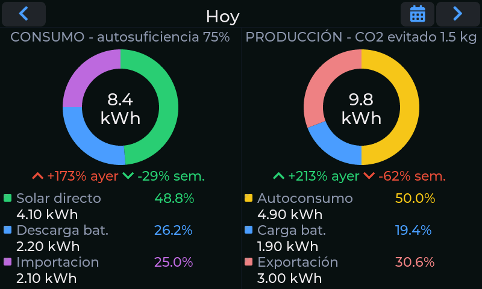

# Estadísticas

La tercera pantalla resume **un día completo** de producción y consumo en dos gráficos de anillo,
con comparaciones frente a ayer y a la semana anterior.

## Los dos anillos

**Consumo** (izquierda) responde a «¿de dónde ha salido la energía que he gastado?»:

| Segmento | Significado |
|---|---|
| **Solar directo** | Energía de los paneles consumida en el momento, sin pasar por la batería. |
| **Descarga bat.** | Energía que ha salido de la batería para alimentar la casa. |
| **Importación** | Energía comprada a la red. |

**Producción** (derecha) responde a «¿a dónde ha ido lo que han producido mis paneles?»:

| Segmento | Significado |
|---|---|
| **Autoconsumo** | Producción solar gastada en casa (sin contar la que va a la batería ni a la red). |
| **Carga bat.** | Producción que ha ido a cargar la batería. |
| **Exportación** | Excedente vertido a la red. |

En el centro de cada anillo está el total del día en kWh, y debajo cada segmento muestra su valor en
kWh y su porcentaje.

## Autosuficiencia y CO2 evitado

En los títulos de cada columna ves dos indicadores del día:

- **Autosuficiencia** (junto a «Consumo»): qué porcentaje de lo que has consumido **no ha salido de
  la red**. Al 100 % no has importado nada.
- **CO2 evitado** (junto a «Producción»): lo que habría emitido la red eléctrica para generar la
  energía solar que has producido. Se calcula con un factor de emisión de **0,15 kg de CO2 por kWh**,
  un valor orientativo del mix eléctrico; si quieres otro, lo fija quien compila el firmware.

Sin consumo o producción apreciables el indicador correspondiente se omite.

## Comparar con ayer y con la semana pasada

Bajo cada anillo aparecen dos flechas de tendencia:

- **ayer**: si estás viendo hoy, compara con ayer **hasta la misma hora**, para que la comparación
  sea justa; si estás viendo un día pasado, compara el día completo con el día anterior completo.
- **sem.**: compara con el mismo día de la semana anterior.

Una flecha **verde** indica un cambio favorable y una **roja** uno desfavorable (más producción es
bueno; más consumo, no); si la diferencia es menor del 5 %, la flecha es gris.

## Cambiar de día

- Las **flechas** de la barra superior avanzan o retroceden un día. Se puede retroceder hasta seis
  días desde hoy.
- El **título** («Hoy» o la fecha) pasa a azul cuando no estás en hoy; **tócalo** para volver a hoy.
- El botón del **calendario** abre un selector de fecha: los días con datos aparecen en verde y se
  desactivan los futuros y los anteriores al primer registro disponible.

Hoy se muestra con los totales en vivo del inversor, y los días anteriores con los que quedaron
guardados.
