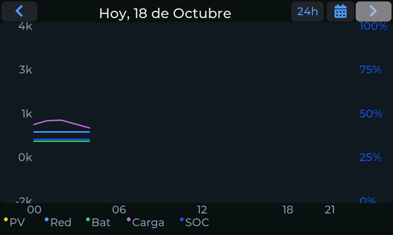
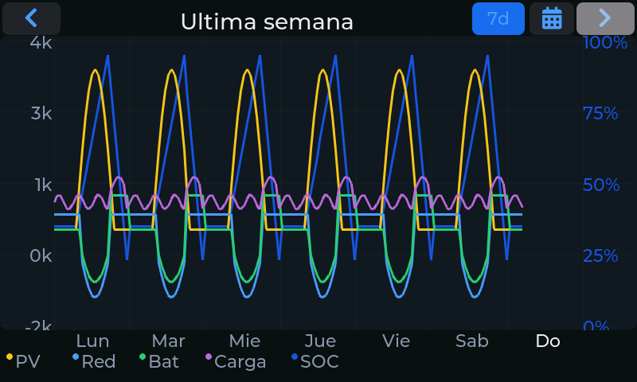
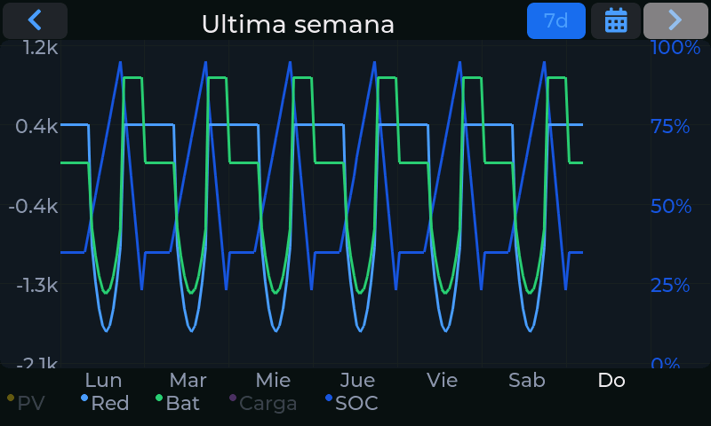

# Gráfica

La segunda pantalla dibuja la **evolución de las potencias** a lo largo del día (o de la semana), con
el nivel de la batería superpuesto.

## Series

Cada curva tiene su color, que coincide con el de la leyenda inferior:

| Serie | Qué representa |
|---|---|
| **PV** | Producción solar (siempre positiva). |
| **Red** | Intercambio con la red: por encima de cero importas, por debajo exportas. |
| **Bat** | Batería: por encima de cero se descarga, por debajo se carga. |
| **Carga** | Consumo de la casa. |
| **SOC** | Nivel de carga de la batería, de 0 a 100 %. |

Los puntos son **medias horarias**, así que la gráfica se dibuja al instante sin consultar la
memoria flash.

## Rango: 24 horas o 7 días

El botón de rango de la barra superior alterna entre:

- **24h**: un día, con un punto por hora.
- **7d**: los siete últimos días seguidos, para ver la evolución de la semana de un golpe. El eje
  horizontal muestra las etiquetas de los días.

Las **flechas** avanzan o retroceden de día (o de semana), y el botón de **calendario** permite saltar
a una fecha concreta; igual que en [Estadísticas](03-estadisticas.md), los días con datos aparecen
marcados.

## Ocultar series con la leyenda

La leyenda es **táctil**: toca el nombre de una serie para ocultarla y vuelve a tocarlo para
mostrarla. Las series ocultas se ven atenuadas en la leyenda. Es útil para quedarte, por ejemplo,
solo con la producción y el consumo. La escala vertical se ajusta a lo que queda visible.

## Ver el detalle de un punto

Toca la gráfica en cualquier hora: aparece una **línea vertical** y un recuadro con el valor de cada
serie en ese punto (en la vista de siete días, con el día y la hora). Toca el recuadro para cerrarlo.

!!! note "Escala del eje vertical"
    Por defecto la escala se ajusta sola a los valores del día (**autoescalado**). Si prefieres una
    escala fija, desactiva el autoescalado y elige el máximo en kW en
    [Configuración → Gráfica](06-configuracion.md#grafica).
