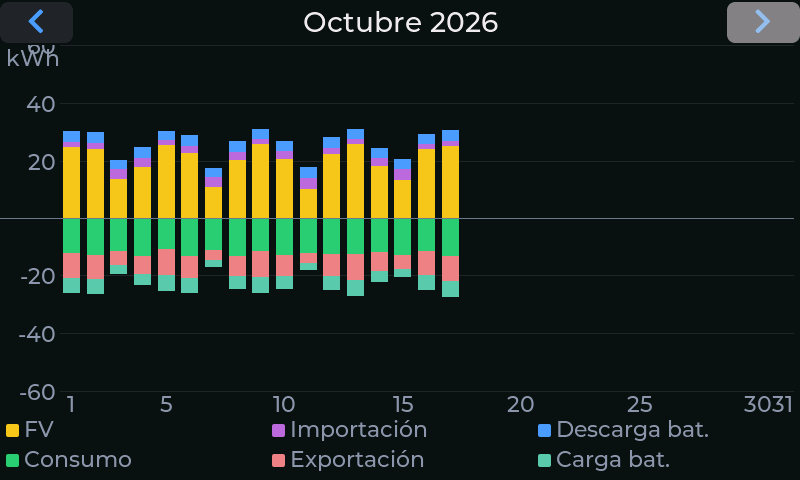

# Perfil de energía

La cuarta pantalla muestra el **balance diario de un mes entero**: una barra por día, para ver de
un golpe cómo ha ido el mes.

## Cómo leer las barras

Cada barra se divide en dos mitades alrededor de la línea de cero:

- **Mitad superior (de dónde sale la energía):** **FV** (producción solar), **Importación** (red) y
  **Descarga bat.** (batería).
- **Mitad inferior (a dónde va):** **Consumo**, **Exportación** y **Carga bat.**

Con los colores de la leyenda inferior se ve a primera vista si fue un día de mucho sol, de mucho
consumo o de dependencia de la red. La escala vertical (en kWh) se ajusta al mes que estás viendo,
con una línea de referencia cada 20 kWh.

## Navegar por los meses

Las **flechas** de la barra superior cambian de mes; el título muestra el mes y el año
(«Octubre 2026»). Los días futuros o sin datos aparecen vacíos.

## Detalle de un día

Toca una barra para ver un recuadro con los valores en kWh de ese día (fecha, producción,
importación, descarga, consumo, exportación y carga de batería). Toca el recuadro para cerrarlo.

!!! note "Comparar con el año anterior"
    Esta pantalla muestra un mes cada vez. Para un resumen con totales y la **comparación con el mismo
    mes del año anterior**, usa los comandos `/mes` y `/anio` del [bot de Telegram](08-telegram.md).
