# Configuración

La quinta pantalla (la última, a la derecha) reúne todos los ajustes del equipo. Desde aquí se puede
configurar todo sin ordenador.

## El menú

La pantalla se presenta como un **menú de ocho entradas** (WiFi y red, Inversor, Gráfica, Telegram,
Pantalla, Acceso web, Actualizaciones y Datos), cada una con un resumen de su estado actual
(«MiRed - 192.168.1.77», «Autoescalado», «Sin clave: web bloqueada», «Versión 4.4.2»…). Toca una para abrir solo esa sección;
el **título de la parte superior** («‹ Inversor») vuelve al menú.

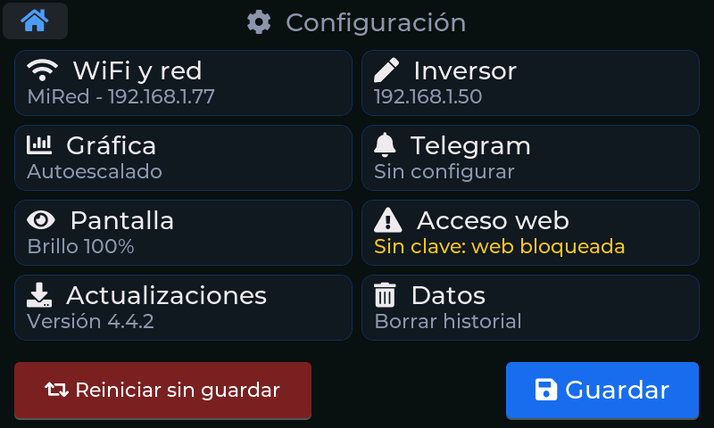

En la parte inferior hay siempre dos botones:

- **Guardar** guarda **todos** los cambios hechos en cualquier sección, no solo la que tienes
  abierta.
- **Reiniciar sin guardar** reinicia el equipo descartando los cambios (pide confirmación).

!!! note "¿Cuándo reinicia el equipo al guardar?"
    Solo cuando cambias algo que se aplica al arrancar: la **WiFi**, la **IP o el número de serie del
    inversor**, el **nombre mDNS** o la **zona horaria**. El brillo, Telegram, la gráfica, el reloj y
    el resto de ajustes se aplican al instante, sin reiniciar.

## Validación inmediata

Cada campo se comprueba **mientras escribes**. Si un dato no es válido, el campo se rodea de rojo y un
aviso en la parte superior te explica el motivo (IP del inversor mal escrita, número de serie con
letras, clave demasiado corta…). Además, solo se pueden teclear los caracteres que tienen sentido
(por ejemplo, dígitos y puntos en una IP). **Guardar** se niega mientras haya un campo inválido y te
lleva a la sección con el error.

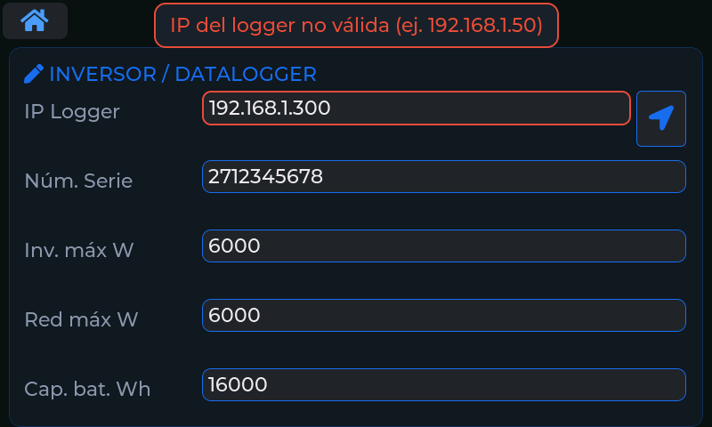

## WiFi y red

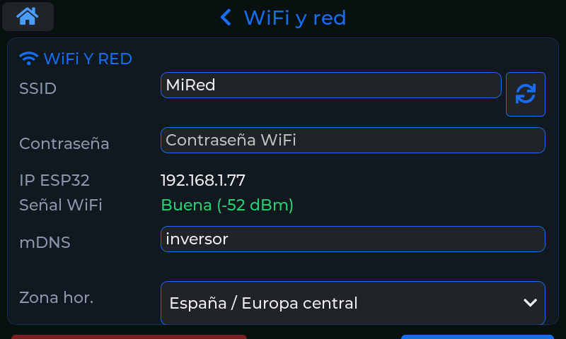

Reúne todo lo relativo a la conexión del equipo:

- **SSID** y **Contraseña** de tu red. El botón de **búsqueda** escanea las redes cercanas y te las
  lista por intensidad de señal; tocar una rellena el nombre.
- La contraseña, vacía (red abierta) o de 8 a 63 caracteres.
- **IP** del equipo e **intensidad de la señal WiFi** (solo lectura, se refrescan solas).
- **mDNS**: el nombre con el que se accede desde la red (`inversor` → `http://inversor.local`).
  Solo letras, números y guiones (máximo 31, sin guion al principio ni al final).
- **Zona horaria**: un desplegable con las zonas más habituales (España y Europa central, Canarias,
  Portugal y Reino Unido, Europa oriental, UTC, México, Colombia y Perú, Argentina y Uruguay, Chile y
  Estados Unidos este, centro y Pacífico), cada una con sus reglas de cambio de hora de verano. Es
  importante que sea la correcta: de ella depende en qué momento empieza y termina cada día en el
  historial. **Un cambio de zona reinicia el equipo.**

## Inversor

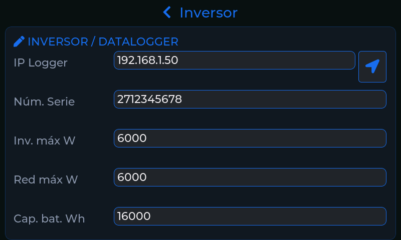

| Campo | Qué es |
|---|---|
| **IP Logger** | La dirección del stick WiFi del inversor. El botón de **localización** junto al campo la **busca automáticamente** (ver más abajo). |
| **Núm. Serie** | Número de serie del stick, en decimal (etiqueta del stick o app SolarmanPV). |
| **Inv. máx W** | Potencia pico de tu inversor; determina el fondo de escala de los indicadores de solar. |
| **Red máx W** | Potencia máxima de red contratada; fondo de escala del indicador de red. |
| **Cap. bat. Wh** | Capacidad total de tu batería en Wh, a mano. Sirve para estimar la autonomía. Solo se usa si no se está usando la del inversor (siguiente fila) o si el inversor no la informa. |
| **Usar la del inversor** | Si está marcada (por defecto), el equipo **lee del inversor la capacidad en Ah que configuró el instalador** (registro 204) y la usa en lugar de la manual. El texto de la casilla muestra lo leído («628 Ah»); mientras no se haya leído, o si el valor no es verosímil, se usa la capacidad manual. Se lee al arrancar y después cada unos 10 minutos. |
| **Tensión nom. V** | Tensión nominal de tu batería, para pasar los Ah del inversor a Wh (Wh = Ah × V). 51,2 V por defecto, que es lo habitual en las baterías de litio de 16 celdas; pon 48 si la tuya es de 48 V. Por ejemplo, 628 Ah a 51,2 V son unos 32.150 Wh. |

Estas dos últimas filas están al final de la sección: desliza hacia arriba para verlas.

**Búsqueda automática de la IP.** Escribe primero el número de serie y pulsa el botón de
localización: el equipo busca el stick en tu red, **verifica** que el dispositivo encontrado responde
con ese número de serie y rellena la IP. Si hay varios candidatos, te deja elegir. Es útil si tu
router cambia la IP del stick: además, el equipo **lo redescubre solo** cuando pierde la
comunicación durante un rato, y actualiza la IP guardada.

## Gráfica

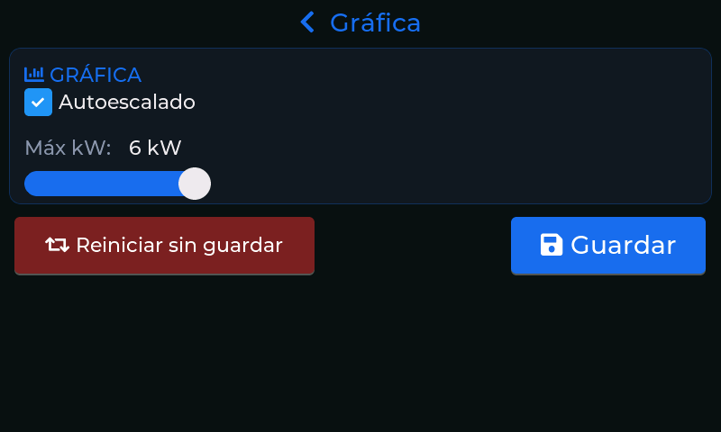

- **Autoescalado**: la escala vertical de la [gráfica](04-grafica.md) se adapta a los valores del
  día.
- **Máximo (kW)**: con el autoescalado desactivado, fija el máximo del eje.

## Telegram

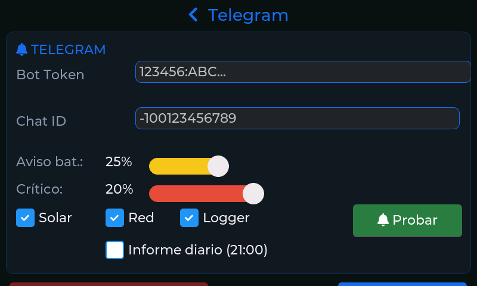

Para recibir avisos y consultar datos desde el móvil (ver [Telegram](08-telegram.md)):

- **Bot Token** y **Chat ID**: los datos de tu bot y tu conversación.
- **Aviso bat.** y **Crítico**: los niveles de batería (en %) que disparan el aviso amarillo y el
  crítico. Por defecto, 25 % y 20 %.
- **Solar**, **Red**, **Logger**: qué tipos de aviso quieres recibir (inicio y fin de la producción
  solar, cortes de red y pérdida de comunicación con el inversor).
- **Informe diario**: si lo marcas, recibirás cada día a las 21:00 un resumen con los totales.
- **Probar**: envía un mensaje de prueba para comprobar que todo funciona.

## Pantalla

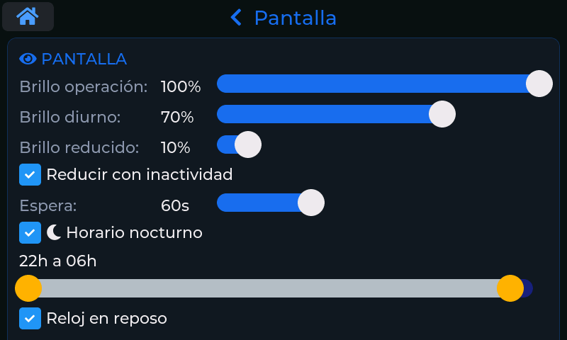

| Ajuste | Para qué sirve |
|---|---|
| **Brillo operación** | Brillo mientras usas la pantalla (10–100 %). |
| **Brillo diurno** | Brillo en reposo durante el día. |
| **Brillo reducido** | Brillo en reposo por la noche. |
| **Reducir con inactividad** y **Espera** | Tras ese tiempo sin tocar (de 10 a 180 segundos), la pantalla baja al brillo de reposo. |
| **Horario nocturno** | Franja horaria (con los dos extremos ajustables) en la que se usa el brillo reducido. |
| **Reloj en reposo** | Al entrar en reposo, muestra un reloj grande en lugar del panel (ver [Panel principal](02-panel-principal.md#reloj-en-reposo)). |

El brillo sube a *Brillo operación* en cuanto tocas la pantalla, aunque sea de noche.

## Acceso web

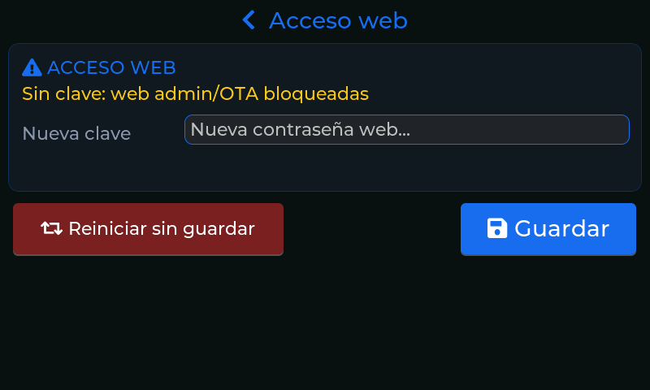

Aquí se define la **clave de la web de administración** (mínimo 8 caracteres). Es el **único sitio**
donde se puede cambiar: deliberadamente no se puede hacer desde la web, para que nadie que acceda a
tu red pueda bloquearte el acceso. Mientras no haya clave, la administración web y las
actualizaciones desde el navegador están **bloqueadas** (el resumen de la sección lo recuerda en
amarillo).

## Actualizaciones

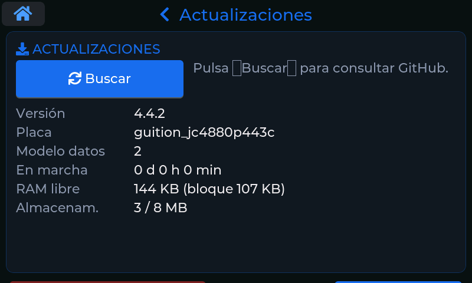

Información del sistema y actualización del firmware **desde la propia pantalla**, sin ordenador:

- **Versión** instalada, **Placa** (de qué modelo es este equipo), **Modelo datos** (ver más abajo),
  tiempo **En marcha**, **RAM libre** (y el mayor bloque contiguo, que es lo que necesita la conexión
  cifrada con GitHub) y **Almacenam.** usado del historial.
- **Buscar** consulta GitHub. A su derecha se ve el estado («Consultando…», «Hay una versión nueva:
  v4.5.0», «Al día»…).
- Tras una consulta correcta aparece un **desplegable con las últimas versiones publicadas**, no solo
  la más nueva: puedes elegir cualquiera (cada una indica si es la **instalada** o una **anterior**). El
  botón **Instalar** cambia según la elegida («Instalar v4.5.0», «Volver a v4.4.1», «Reinstalar
  v4.4.2») y pide **confirmación** antes de empezar.

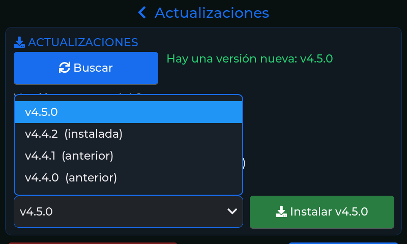

Durante la instalación la pantalla muestra el avance y se congela el resto de la interfaz; al
terminar, el equipo **se reinicia solo**. Si algo falla (sin WiFi, sin memoria, versión
incompatible…), no se instala nada y el motivo aparece en esta misma sección.

**Modelo de datos.** Cada versión del firmware lleva un número que indica el formato en que guarda sus
datos (configuración, historial, copias de seguridad). Se puede **instalar una versión con el mismo
modelo o con uno superior** (la nueva se encarga de migrar lo guardado), pero **no una con un modelo
inferior** al instalado: no sabría leer lo que ya hay en el equipo. Por eso volver a una versión
anterior solo funciona mientras no haya cambiado el modelo de datos; si lo ha hecho, el equipo lo
rechaza antes de instalar nada. Esta protección vale también para la subida manual del fichero.

!!! note "Sin contraseña"
    En la pantalla no se pide la clave de administración: quien tiene el equipo delante ya puede
    cambiar cualquier ajuste (la clave web solo se define aquí). La web, en cambio, sí la exige.

## Datos

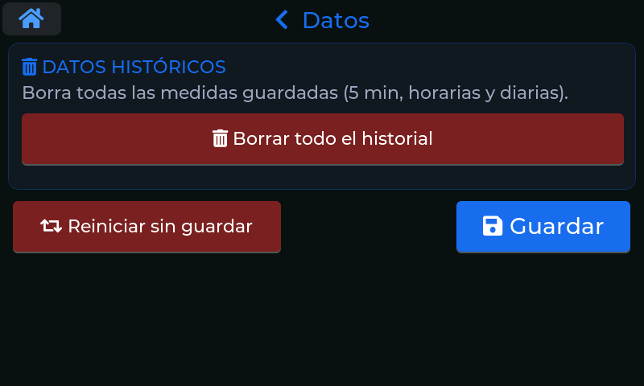

Permite **borrar todo el historial** guardado (medidas de 5 minutos, horarias y diarias). Es
irreversible, así que pide **dos confirmaciones seguidas**. Tu configuración no se toca.
