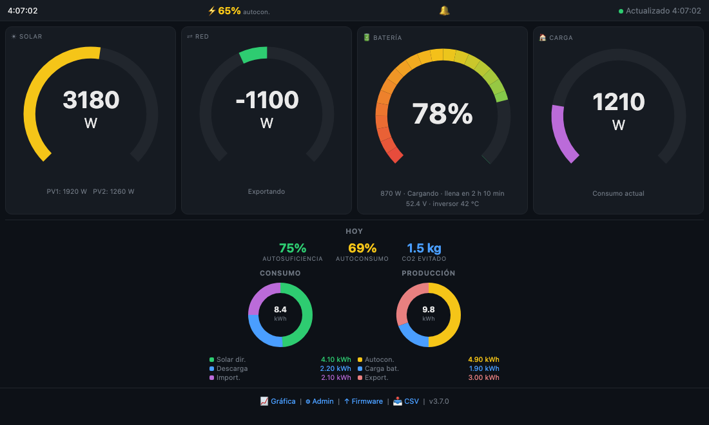
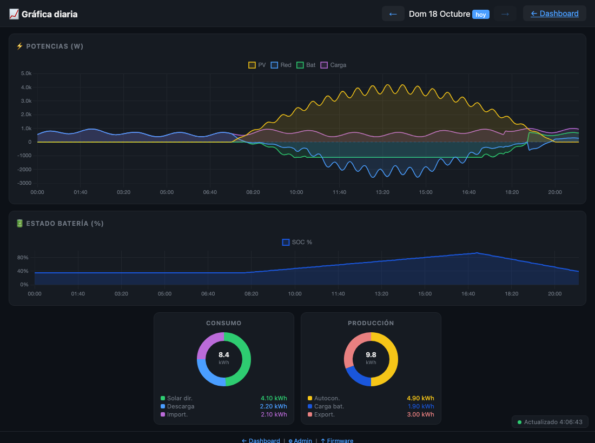
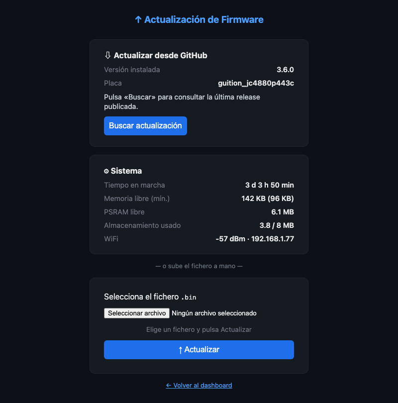

# Interfaz web

El equipo incluye un servidor web: desde el ordenador, la tableta o el móvil de cualquier persona de
tu red puedes ver los datos, consultar el historial, descargarlo y ajustar la configuración, sin
instalar nada.

## Cómo acceder

Abre el navegador y escribe:

- `http://inversor.local` (el nombre `inversor` es el **mDNS** configurable en
  [Configuración → Red](06-configuracion.md#red)), o
- `http://` seguido de la **IP** del equipo, que figura en **Configuración → Red**.

!!! note "Solo desde tu red"
    La web no está pensada para publicarse en internet y no cifra el tráfico (HTTP). Úsala desde tu
    red local; si necesitas acceso desde fuera, hazlo a través de una VPN de tu router.

Las páginas de lectura (panel, gráfica, exportación a CSV) son accesibles sin clave. Las que
cambian algo (administración, actualización de firmware) requieren la
[clave de administración](#clave-de-administracion).

## Panel

Es el equivalente web del [panel principal del dispositivo](02-panel-principal.md) y se actualiza
solo cada cinco segundos, sin recargar la página:

- La **barra superior** muestra la hora, el **autoconsumo** instantáneo, el indicador de
  **notificaciones** y el estado de la conexión (punto verde = datos al día, rojo = error).
- Cuatro **medidores**: **Solar** (con PV1 y PV2), **Red** (negativo = exportando), **Batería** (con
  la potencia, el estado, la estimación de autonomía —«llena en 2 h 10 min»— y, si el inversor lo
  informa, la **tensión** y la **temperatura del inversor**) y **Carga**.
- Bajo ellos, el bloque **Hoy**: **autosuficiencia**, **autoconsumo** y **CO2 evitado** del día, y
  los dos anillos de consumo y producción con el desglose en kWh.
- El **pie** enlaza a la gráfica, a la administración, a la actualización de firmware y al panel
  de descarga **CSV**, y muestra la versión instalada.

En una pantalla estrecha (un móvil) los cuatro medidores pasan a disponerse en dos columnas.

### Instalarla como aplicación

El panel puede instalarse en el móvil o el ordenador como si fuera una aplicación (con su icono):
en el navegador, usa **Añadir a pantalla de inicio** o **Instalar aplicación**. Se abrirá a pantalla
completa, sin barra de direcciones.

### Notificaciones del navegador

El icono de campana de la barra superior permite activar las **notificaciones del navegador**: mientras
tengas el panel abierto (aunque sea en segundo plano), te avisará de las mismas alertas que
Telegram (batería, red, solar, inversor). No son notificaciones push reales: no llegan con la
pestaña cerrada; para eso, usa [Telegram](08-telegram.md).

## Gráfica diaria

Muestra un día completo con **un punto cada cinco minutos**, en dos gráficos: las **potencias**
(PV, Red, Batería y Carga) y el **nivel de batería**, con los anillos del día debajo.

- Las **flechas** de la parte superior cambian de día; la etiqueta «hoy» indica el día actual.
- Si estás viendo el día de hoy, la gráfica **se actualiza sola** y añade los puntos nuevos sin
  recargar. A las 00:00 cambia al día nuevo automáticamente.
- Pasa el cursor (o el dedo) sobre la gráfica para ver el valor exacto de cada serie.
- Puedes ocultar una serie pulsando su nombre en la leyenda.

## Descargar los datos en CSV

En el pie del panel, **CSV** despliega las opciones de descarga:

- **Rango de fechas**: elige el día inicial y el final (hasta 366 días) y pulsa **Descargar**.
- **Mes completo**: elige un mes y pulsa **Mes completo** para descargar `deye_AAAAMM.csv`.

El fichero tiene una fila por día con producción, exportación, importación, consumo, carga y
descarga de batería (en kWh) y el nivel de batería al empezar y terminar el día. Es un texto
separado por comas que se abre directamente en Excel, LibreOffice o Google Sheets.

## Administración

La página `/admin` permite configurar el equipo desde el navegador. Cada bloque tiene los mismos
ajustes que su equivalente en [Configuración](06-configuracion.md):

| Bloque | Qué permite |
|---|---|
| **Red** | Ver la WiFi activa y cambiar el nombre mDNS. (La WiFi solo se cambia desde la pantalla, por seguridad.) |
| **Inversor / Datalogger** | IP y número de serie del stick, y las potencias y capacidad de batería. |
| **Gráfica** | Autoescalado y máximo en kW. |
| **Telegram** | Token, chat, umbrales de batería, tipos de aviso e informe diario. |
| **MQTT / Home Assistant** | Broker, puerto, usuario, contraseña y prefijo (ver [MQTT](09-home-assistant-mqtt.md)). |
| **Pantalla** | Brillos, inactividad, horario nocturno y reloj en reposo. |
| **Copia de seguridad** | Descargar y restaurar la configuración (ver [Datos y copias](10-datos-y-copias.md)). |
| **Copia de seguridad de datos históricos** | Descargar y restaurar el historial. |
| **Borrar historial** | Vacía el historial (con doble confirmación). |

Un botón **Guardar** aplica los cambios y otro permite **reiniciar** el equipo, necesario para los
que se aplican al arrancar.

### Clave de administración {#clave-de-administracion}

Las páginas que cambian algo (`/admin`, `/update`, importar, borrar, reiniciar) están
protegidas:

- **Sin clave definida, están bloqueadas**: el navegador recibe un error 403 que indica cómo
  definirla. Esto evita que alguien de tu red pueda tocar el equipo mientras no lo hayas protegido.
- **Con clave**, el navegador pide el usuario `admin` y esa clave.
- Tras varios intentos fallidos seguidos, cada fallo adicional **duplica la espera** obligatoria (hasta
  cinco minutos).
- Las peticiones que modifican algo se rechazan si no se originan en la propia página del equipo
  (protección contra páginas maliciosas que intenten usar tu sesión).

La clave **solo se define desde la pantalla táctil** (**Configuración → Acceso web**) o desde el
asistente de primer arranque, nunca desde la web.

## Actualización de firmware

La página `/update` (también protegida por la clave) permite poner al día el programa del equipo. Se
explica en [Instalación y actualización del firmware](13-instalacion-del-firmware.md#actualizar-el-firmware),
y aquí encontrarás además un bloque **Sistema** con información de estado:

El bloque **Sistema** muestra el tiempo que lleva encendido el equipo, la memoria libre (y su mínimo
histórico), la PSRAM libre, el almacenamiento usado, la señal WiFi y la IP. Se refresca cada diez
segundos y es lo primero que conviene consultar si el equipo se comporta de forma rara.
