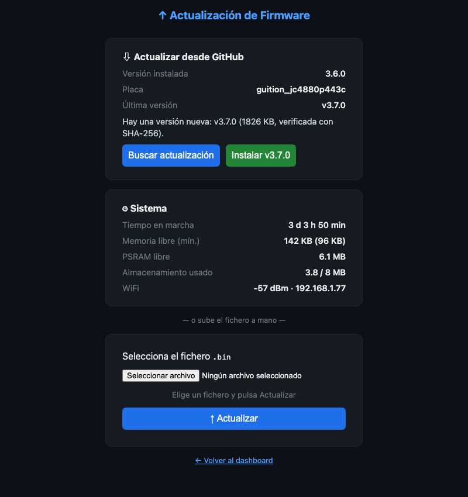

# Instalación y actualización del firmware

Este es el único capítulo técnico del manual. Está dirigido a quien **instala el programa por primera
vez** en una placa o a quien lo **mantiene al día**. Si tu equipo ya viene configurado y funcionando,
no necesitas leerlo, salvo la parte de [actualizar el firmware](#actualizar-el-firmware).

## Qué necesitas

- Una de las [placas compatibles](index.md#equipos-compatibles) con su cable USB.
- Un ordenador con **[PlatformIO](https://platformio.org/)** (la extensión de VS Code o la línea de
  comandos `pio`) y **Python 3.8 o superior**.
- El código del proyecto:

```bash
git clone https://github.com/lrlopez/deye-monitor.git
cd deye-monitor
```

!!! note "La primera instalación siempre se hace por USB, compilando"
    Los ficheros `.bin` que se publican en las *Releases* de GitHub contienen **solo la aplicación**:
    sirven para **actualizar** un equipo que ya tiene el firmware, no para estrenar una placa en
    blanco (les falta el cargador de arranque y la tabla de particiones). La primera vez hay que
    volcar el firmware con PlatformIO.

## Elegir el entorno de tu placa

El fichero `platformio.ini` define un **entorno** por placa. Elige el tuyo:

| Placa | Entorno |
|---|---|
| Sunton 4827S043 (ESP32-S3, 480 × 272) | `sunton_4827s043` |
| Guition JC1060P470 (ESP32-P4, 1024 × 600) | `guition_jc1060p470` |
| Guition JC4880P443C (ESP32-P4, 480 × 800 girado a 800 × 480) | `guition_jc4880p443c` |

Usar el entorno de otra placa deja la pantalla o el táctil sin funcionar correctamente.

## Compilar y volcar

Conecta la placa por USB y ejecuta, sustituyendo el entorno por el tuyo:

```bash
pio run -e sunton_4827s043 --target upload
```

La primera compilación descarga las plataformas y bibliotecas y tarda unos minutos; las siguientes
son rápidas. Para ver lo que escribe el equipo mientras arranca:

```bash
pio device monitor
```

Las placas ESP32-P4 usan una versión de la biblioteca gráfica con un parche que se aplica
automáticamente al compilar; no tienes que hacer nada.

Para compilar sin volcar, por ejemplo para comprobar que todo funciona:

```bash
pio run -e guition_jc4880p443c
```

El resultado es `.pio/build/<entorno>/firmware.bin`.

## Primer arranque

Con la memoria vacía, el equipo arranca, **crea sus ficheros de datos** (puede tardar un poco la
primera vez) y muestra el [asistente de primer arranque](01-primeros-pasos.md#asistente-de-primer-arranque).
En el monitor serie verás algo parecido a esto cuando todo va bien:

```
[WiFi] Conectado: 192.168.1.34
[NTP] Sincronizado
[mDNS] Activo: inversor.local
[Solarman] Conectando a 192.168.1.214:8899
[Live] PV:705W Grid:-914W Bat:-37W(99%) Load:360W
```

## Actualizar el firmware

Una vez instalado, el firmware se actualiza **por la red**, sin cables. Hay dos formas, ambas desde la
página **`/update`** de la web del equipo (`http://inversor.local/update`), que está protegida por la
[clave de administración](07-interfaz-web.md#clave-de-administracion) (sin clave definida, la página
está bloqueada).



### Desde GitHub (recomendado)

1. En el bloque **Actualizar desde GitHub**, pulsa **Buscar actualización**. El equipo consulta la
   última *release* publicada y compara con la versión instalada (que se muestra junto al nombre de
   tu placa).
2. Si hay una versión nueva, aparece el botón **Instalar**, con un enlace a las notas de la versión.
   Pulsa **Instalar** y **confirma** en el segundo paso.
3. El equipo **descarga** el fichero de **tu placa**, comprueba su integridad y, solo si todo es
   correcto, lo instala y **se reinicia**. Mientras tanto, la pantalla muestra el avance y se congela
   el resto de la interfaz.

La descarga se verifica antes de instalar: conexión cifrada con certificado comprobado, tamaño,
cabecera del fichero y **huella SHA-256** publicada por GitHub. Si cualquier comprobación falla, **no
se instala nada** y el equipo sigue funcionando con la versión actual.

!!! note "Si falla la descarga"
    Si GitHub cambiara de autoridad certificadora, la descarga automática podría fallar «cerrada» (por
    seguridad). La subida manual, descrita a continuación, seguiría funcionando.

### Subiendo el fichero a mano

1. Descarga de la página de *Releases* del proyecto el fichero de tu placa
   (`deye_monitor_<placa>_<versión>.bin`).
2. En `/update`, en el bloque inferior, elige el fichero y pulsa **Actualizar**.
3. La barra de progreso muestra la subida; al terminar, el equipo se reinicia solo.

### Por cable, con PlatformIO

Si el equipo está conectado por USB, `pio run -e <entorno> --target upload` actualiza igualmente.

!!! note "Tu configuración y tu historial se conservan"
    Actualizar el firmware no borra la configuración ni el historial: viven en zonas de memoria
    distintas a la del programa.

## Versiones y novedades

Cada versión publicada en GitHub incluye un fichero por placa y el **registro de cambios**
(`CHANGELOG.md`), donde se detalla lo nuevo, lo corregido y los cambios que pueden afectar a tu
instalación. La **versión instalada** aparece en la pantalla de arranque, en la página `/update` y en
el pie del panel web. Las versiones de desarrollo llevan un sufijo con el número de cambios y el
identificador de la compilación (por ejemplo, `3.7.0+24.g1a2b3c4`).

## Ajustes avanzados de compilación

Algunos umbrales internos (los límites de las alertas, el tiempo del doble toque, el factor de CO2…)
están reunidos con nombre en `src/tuning.h` y pueden cambiarse al compilar añadiendo una línea
`-DTUNE_NOMBRE=valor` a los `build_flags` de tu entorno en `platformio.ini`. Es un ajuste para quien
compila su propio firmware; no hace falta tocar nada para un uso normal.

## Documentación

Este manual está en la carpeta `docs/manual` del repositorio, escrito en Markdown. Se publica
automáticamente como **web** (GitHub Pages), como **PDF** y como **ZIP descargable** con cada
versión; las instrucciones para generarlo en local están en `docs/manual/README.md`.
